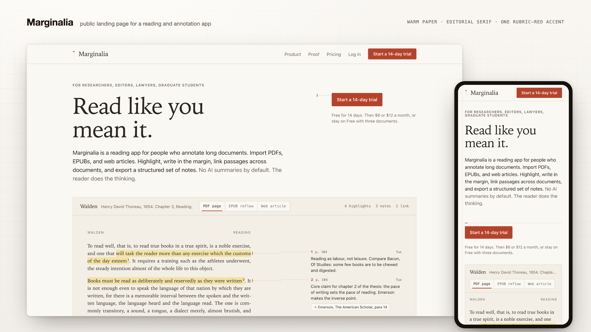
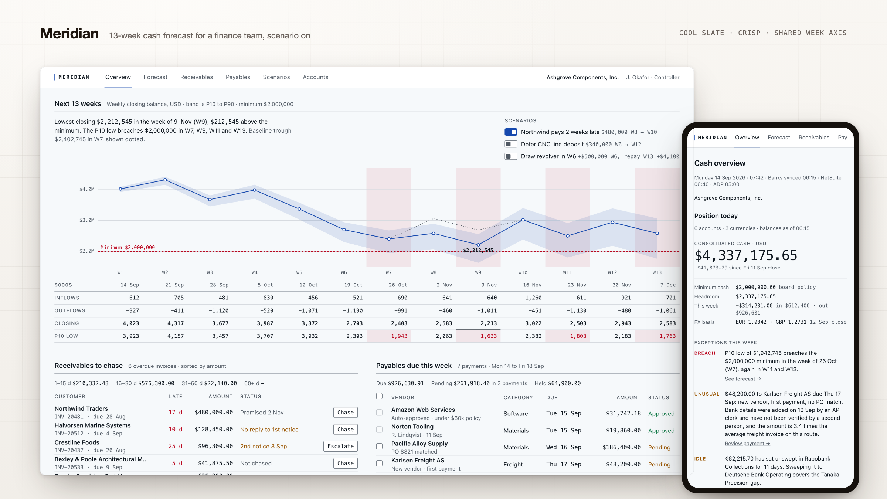
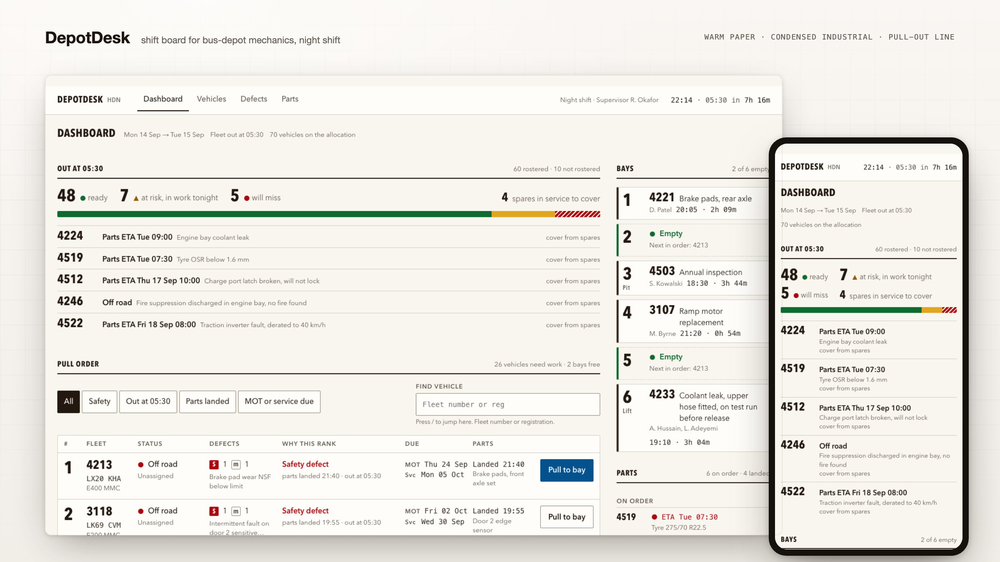
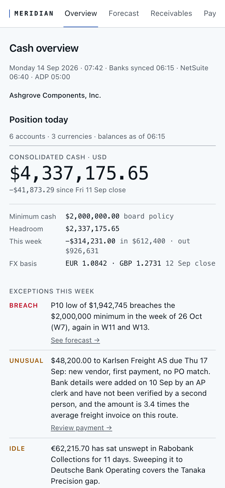
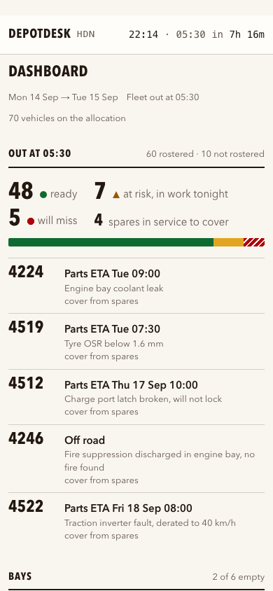
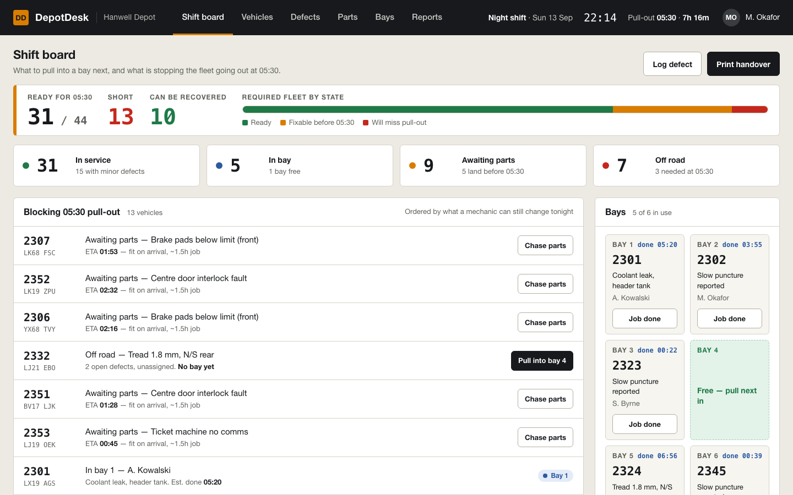
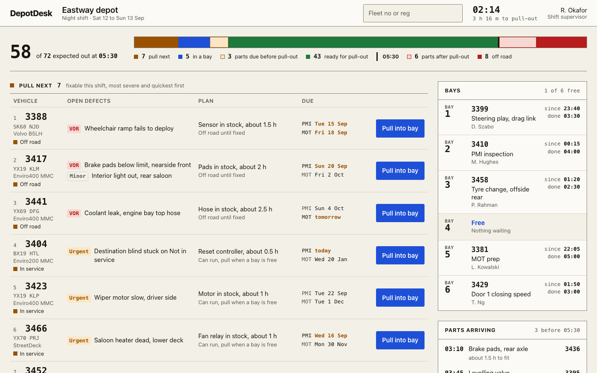
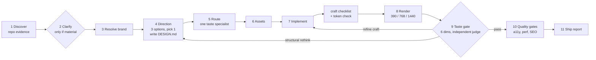

<h1 align="center">Creative Frontend Director</h1>

<p align="center">
Give your coding agent a design direction worth building.
</p>

<p align="center">
<a href="LICENSE"></a>

<a href="#supported-hosts"></a>
</p>

**Build interfaces that belong to your product.** Creative Frontend Director is an agent skill that turns product context into a written design direction, implemented UI, and a review of real screenshots. Use it to build a landing page, shape a dashboard, improve an existing flow, or carry your brand into the next screen.

[Quick start](#quick-start) · [Sample screenshots](#sample-screenshots) · [Example prompts](#example-prompts) · [How it works](#how-it-works) · [Supported hosts](#supported-hosts)

<p align="center">
<a href="docs/showcase/marginalia-1440.png"></a>
</p>

<p align="center"><sub>Marginalia, a reading and annotation app. Real rendered UI, presented in a desktop-and-phone composition. <a href="docs/showcase/marginalia-1440.png">Desktop screenshot</a> · <a href="docs/showcase/marginalia-390.png">Phone screenshot</a> · <a href="docs/showcase/marginalia-DESIGN.md">Written design direction</a></sub></p>

## Why use this skill?

The first design decision happens before the first component. A mechanic needs a departure deadline and a ranked repair queue. A finance team needs a forecast tied to the same weeks as its table. A reading app can demonstrate its value through the page's own margins.

The director gives your agent a process for making those decisions:

- **Start with the user's job.** Read the product, content, constraints, and existing UI before choosing a layout.
- **Make the direction explicit.** Record typography, color, spacing, components, motion, and a product signature in `DESIGN.md`.
- **Keep the product recognizable.** Preserve brand rules and intentional patterns when extending or improving an existing interface.
- **Review what actually rendered.** Inspect phone, tablet, and desktop screenshots; fix structural problems before polishing details.

The skill works through your coding agent and the target project's stack. It supplies the design workflow, reference material, and review gates; your agent builds the interface.

## Quick Start

Install the skill once, then use it from the project you want to build or improve.

```bash
git clone https://github.com/naufalrandi/creative-frontend-director.git
cd creative-frontend-director
./setup.sh                 # default: ~/.agents/skills
```

In your target project's Codex session, explicitly invoke it with:

```text
$creative-frontend-director
Build the main dashboard for this product. Read the repo first, preserve
our existing brand, and verify the result on phone, tablet, and desktop.
```

Other hosts have their own invocation syntax; see [supported hosts](#supported-hosts). Ordinary requests such as “build the dashboard” can also activate the skill when the host supports discovery by description.

**Requirements:** Git, Bash, and standard Unix tools. Python 3 is needed for optional Claude hook installation and manifest maintenance. Visual verification needs a host browser tool, Playwright, or headless Chrome. Target projects keep their existing framework and package manager.

<details>
<summary>Installation options</summary>

```bash
./setup.sh --list                # show host presets
./setup.sh --agent claude        # explicit host directory
./setup.sh --agent codex         # Codex skills directory
./setup.sh --all                 # default plus detected host locations
./setup.sh --with-hook           # merge Claude UserPromptSubmit routing hook
./setup.sh --link                # use checkout through a symlink
./setup.sh /custom/skills        # custom destination root
```

Installation replaces the existing `creative-frontend-director` directory at the selected destination. Back up local edits first. Do not select a destination inside this checkout or its parent as a custom root: the current installer does not guard source/destination overlap. `--with-hook` modifies global Claude settings and creates a backup. Host locations and hook details: [installer](<scripts/install.sh>), [routing guide](<hooks/README.md>).

</details>

## Example prompts

Give the agent the user, the task, and the constraints you already know. It discovers the remaining context in your repo and asks only when an answer would materially change the work. Invoke the skill using your host's syntax, then try one of these:

**Build a product screen**

```text
Build the main dashboard for a bus-depot maintenance team on a night shift.
Show what will be ready for the 05:30 departure, what could miss it, and
which vehicle to pull into a bay next. Use our existing frontend stack.
Write the design direction before implementing, then render all three widths.
```

**Improve an existing page**

```text
Improve our settings page's hierarchy, spacing, and interaction states.
Preserve our brand, routes, and existing behavior. Inspect the current UI,
fix the highest-impact problems, and compare before and after screenshots.
```

**Review before changing code**

```text
Review the onboarding flow at 390, 768, and 1440 px. Score product fit,
hierarchy, typography, rhythm, identity, and finish. Show the three
highest-impact issues with screenshot evidence. Report findings only.
```

**Extend your design system**

```text
Extract our existing color, type, spacing, and component rules into DESIGN.md
and a token file for our stack. Mark each rule as observed or inferred,
and document inconsistencies for a later redesign.
```

## Capabilities

| Need | Director behavior |
|---|---|
| New product or page | Discover users, jobs, content, constraints, and existing patterns before choosing composition |
| Redesign or polish | Inspect first, preserve intentional identity, distinguish structural debt from craft issues |
| Product-specific identity | Commit to wordmark, typography, palette temperature, accent budget, shape, and motion |
| Better UI and UX | Design hierarchy, navigation, information grouping, states, and responsive behavior around real tasks |
| Visual review | Inspect screenshots at 390, 768, and 1440 px; score six dimensions and prioritize fixes |
| Design-system extraction | Document observed and inferred rules, tokens, and inconsistencies in the existing product |
| Public pages | Apply route-appropriate SEO, Open Graph, and performance checks after visual direction stabilizes |

Scope includes dashboards, landing pages, admin tools, forms, onboarding, components, and whole frontend projects. Backend-only, infrastructure, database, and non-visual refactors are outside scope. Each request uses a [workflow-specific subset of stages](workflows/workflows.md): a visual review reports findings; an extraction documents existing rules; a new product explores a full direction.

## Sample screenshots

Three example products, three different directions. Each run started with a product brief and a short task prompt, without supplied brand assets. The images are saved renders from those runs; wide presentation images add framing around desktop and phone captures. Open the linked screenshots to inspect them at full size.

| Example | Surface | Design decision to look for |
|---|---|---|
| [Marginalia](#marginalia--a-page-that-reads-like-the-product) | Public landing page | Margin notes become the page's organizing idea |
| [Meridian](#meridian--a-forecast-you-can-read-against-the-table) | Finance overview | Chart and table share a thirteen-week axis |
| [DepotDesk](#depotdesk--a-dashboard-built-around-departure-time) | Maintenance dashboard | Readiness and repair priority follow the 05:30 departure |

### Marginalia — a page that reads like the product

**Prompt:** `create the landing page`

A reading app for people who annotate long documents. The *Running Margin* direction shown at the top of this README turns a reading view into the hero: a public-domain Thoreau passage, example notes, warm paper, editorial serif type, and a rubric-red accent. The page demonstrates the product's central interaction.

[Desktop · 1440 px](docs/showcase/marginalia-1440.png) · [Phone · 390 px](docs/showcase/marginalia-390.png) · [Brief](docs/showcase/marginalia-brief.md) · [Directions](docs/showcase/marginalia-directions.md) · [DESIGN.md](docs/showcase/marginalia-DESIGN.md) · [Self-review](docs/showcase/marginalia-review.md)

### Meridian — a forecast you can read against the table

**Prompt:** `build the main cash overview screen`

Cash-flow intelligence for a finance team. Cool slate and mono numerals support a precise, dense overview. The 13-week forecast and the table share the same columns, so a scenario toggle updates both and cash-minimum breaches appear in the corresponding chart and grid positions.

<p align="center"><a href="docs/showcase/meridian-1440-scenario.png"></a></p>

[Desktop · 1440 px](docs/showcase/meridian-1440.png) · [Scenario enabled](docs/showcase/meridian-1440-scenario.png) · [Phone · 390 px](docs/showcase/meridian-390.png) · [Brief](docs/showcase/meridian-brief.md) · [Directions](docs/showcase/meridian-directions.md) · [DESIGN.md](docs/showcase/meridian-DESIGN.md) · [Self-review](docs/showcase/meridian-review.md)

### DepotDesk — a dashboard built around departure time

**Prompt:** `build the main dashboard`

A maintenance tool for bus-depot mechanics on a night shift. Condensed industrial type and warm workshop paper support a readiness bar with a hatched “will miss” segment and a pull order ranked against the 05:30 departure. The screen starts with the shift's deadline and the work that threatens it.

<p align="center"><a href="docs/evals/s12-with-skill-v4.2.png"></a></p>

[Desktop · 1440 px](docs/evals/s12-with-skill-v4.2.png) · [Phone · 390 px](docs/evals/s12-with-skill-v4.2-390.png) · [Scenario](evals/scenarios.md#s12-finish-and-identity-commitment) · [Directions](docs/evals/s12-directions.md) · [DESIGN.md](docs/evals/s12-DESIGN.md) · [Implementer self-review](docs/evals/s12-review.md) · [Judge findings and verdict](evals/baseline.md)

**Recorded verdict: REFINE.** The independent judge scored this run 24/30, with Finish at 3/5. It caught tablet collisions and hidden information that the implementer's self-review missed. The screenshot is useful evidence of the direction; the recorded result still requires fixes.

### Phone gallery · 390 px

<table>
  <tr>
    <th>Marginalia · reading app</th>
    <th>Meridian · cash overview</th>
    <th>DepotDesk · shift board</th>
  </tr>
  <tr>
    <td width="33%" valign="top"><a href="docs/showcase/marginalia-390.png"></a></td>
    <td width="33%" valign="top"><a href="docs/showcase/meridian-390.png"></a></td>
    <td width="33%" valign="top"><a href="docs/evals/s12-with-skill-v4.2-390.png"></a></td>
  </tr>
</table>

Widths describe CSS viewports; some captures use a 2× device scale. DepotDesk's phone capture was center-cropped from a constrained 390 px render, as recorded in its [capture notes](docs/evals/s12-review.md#render-evidence).

## Before and after: the same dashboard brief

Two fresh agents were given the DepotDesk fixture and the prompt **"Build the main dashboard."** One had this skill. One did not.

| Without the skill | With the skill, v4.0 |
|---|---|
| [](docs/evals/s1-without-skill.png) | [](docs/evals/s1-with-skill.png) |
| Four stat counters, every region in a rounded card, pill badges, a chart added "by system", main-plus-rail layout. Competent. Could be any ops dashboard. | The fleet ranked against the 05:30 pull-out, a line drawn through the list separating what goes out from what does not, bays as a physical board, no chart, no cards around content. |
| No written brief. No direction. No review. | `.design/brief.md`, three scored directions, a ten-section `DESIGN.md`, a two-round rubric review, seven screenshots. |

Artifacts from the skilled run: [directions](docs/evals/s1-directions.md), [DESIGN.md](docs/evals/s1-DESIGN.md), [review](docs/evals/s1-review.md). Full log in [evals/baseline.md](evals/baseline.md).

This is one historical comparison under the recorded fixture constraints. It illustrates a change in composition and process. The v4.2 DepotDesk run above adds identity commitments, a craft checklist, and an independent judge; its REFINE verdict remains recorded in the [baseline log](evals/baseline.md).

## How It Works



New products use the full sequence. Smaller requests reuse existing direction or run only the relevant stages; see the [workflow matrix](workflows/workflows.md).

Six rules hold the workflow together:

1. **Written, not thought.** The brief, the three directions, `DESIGN.md`, and the review are files. A step that only happened in reasoning did not happen.
2. **Ask once, only if it matters.** At most four questions, recommended answer first, and only when the answer would change direction, structure, or scope. Every guess is reported at the end with the rule that chose it.
3. **One specialist per surface.** Other taste skills execute the direction in `DESIGN.md`. They do not redefine it.
4. **No render, no done.** Screenshots at three widths are the input to the gate, not a nice-to-have.
5. **Rethink before polish.** A rubric score under 3 on product fit, hierarchy, typography, rhythm, or identity sends the agent back to structure. Shadows and radii are not allowed to fix a weak concept.
6. **Commit and finish.** `DESIGN.md` must state six identity commitments (wordmark, type pairing, palette temperature, accent budget, shape, motion), and the sixth rubric dimension, Finish, is capped at 2 while any craft-checklist P0 is open: states, empty and loading, real content, token conformance.

## What You Get In Your Repo

```text
DESIGN.md                 the locked direction: theme, tokens, type, spacing, components, motion, voice, anti-patterns, signature
.design/
  brief.md                what the product is, tagged observed / provided / inferred
  directions.md           three structurally different directions, scored, one picked
  brand-spec.md           tokens extracted from your real brand source, when you have one
  review.md               the rubric score, rounds, and remaining weaknesses
  screens/                phone, tablet, desktop renders
```

Files depend on the workflow: a visual review writes findings, while an extraction documents existing rules. When implementation runs, the ship report names changed files, captured screens, defaults, skipped checks, remaining assets, and the rubric score with its scorer.

The next session can read the same `DESIGN.md` and continue from the written direction. Start with the [design direction template](templates/DESIGN.md) or [brand extraction template](templates/brand-spec.md) to inspect the format.

## Anti-Slop, As Recipes

Prohibitions get negotiated away. So each default reflex is paired with what to build instead. Three of the fifteen:

| Default reflex | Build this instead |
|---|---|
| a row of four KPI cards | one primary number with its trend and context, the rest inline or in a compact table with tabular numerals |
| sidebar plus card grid | start from the questions the user asks on arrival; answer each in its tightest form; pick navigation from module count and switching frequency |
| chart to look sophisticated | a chart only when a decision depends on shape over time or comparison, otherwise a number with a delta |

Full table in [core/anti-slop.md](core/anti-slop.md), plus the two tests every screen must pass: the removal test and the brand-removal test.

## Animation and interactive design

Choose tools by the experience, not by library count. These are optional target-project integrations—not dependencies bundled with this Markdown/Bash package. Current shipped motion guidance remains restrained; advanced GSAP/Three.js choreography requires explicit implementation instructions and verification in the target project.

| Tool | Useful role | Integration boundary |
|---|---|---|
| Native CSS / Web Animations | Hover, press, simple reveals, lightweight transitions | First choice when it covers the interaction |
| [Motion](https://motion.dev/) | UI state transitions, gestures, shared-element continuity | Use the installed framework-compatible API; preserve focus and reduced-motion behavior |
| [GSAP](https://gsap.com/) | Authored timelines, SVG choreography, scroll storytelling | Scope timelines and cleanup; preserve native scrolling and mobile reading order |
| [Three.js](https://threejs.org/) | Meaningful spatial scenes and product exploration | Keep usable DOM controls and a static fallback; manage rendering and GPU resources |
| [Taste Skill](https://github.com/Leonxlnx/taste-skill) | Optional public-page composition and visual critique reference | Brand and written direction win; verify installed version and scope before use |

When combining engines, assign one owner per animated property. For example, Motion controls DOM feedback, GSAP controls narrative progress, and Three.js renders the scene. Never let two engines write the same transform or camera value. Reduced motion, keyboard/touch access, loading failures, and teardown are requirements—not optional polish.

Example request:

```text
Create an interactive product landing page. Write the design direction first.
Use Motion for controls, GSAP for one purposeful narrative sequence, and
Three.js only if product exploration benefits from depth. Preserve normal
scrolling, accessible DOM content, and reduced-motion/static fallbacks.
Verify mobile layouts and record the interaction, not only screenshots.
```

Existing recipes: [motion](<reference/motion-recipes.md>), [composition and layout](<reference/design-reference.md>), [specialist routing](<core/specialist-router.md>).

## Works with your other skills

The director sits above specialist taste skills, not beside them. A registry in [core/specialist-router.md](core/specialist-router.md) maps the chosen direction to at most one specialist, verifies it exists on the host, and hands it `DESIGN.md`. Engineering, accessibility, browser QA, and data-viz skills are called as needed in the later stages.

On Claude Code, a small `UserPromptSubmit` hook makes the director the first design authority before any sibling skill loads:

```bash
./setup.sh --with-hook
```

Other hosts use an instructions-file snippet or a rule file. See [hooks/README.md](hooks/README.md).

## Supported hosts

The repo includes adapters for the eight hosts below. [reference/harness-adapters.md](reference/harness-adapters.md) maps stage actions to each host's tools and documents fallbacks. Activation, browser access, and subagent support depend on the host and its configuration.

| Host | Install | Invoke |
|---|---|---|
| Claude Code | default | Skill tool, auto, hook routing |
| Codex CLI and IDE | default | `$creative-frontend-director` or auto |
| OpenCode | default or `--agent opencode` | `skill` tool or auto |
| Antigravity CLI `agy` | `--agent agy` | `/creative-frontend-director` or auto |
| Gemini CLI | default or `--agent gemini` | `activate_skill` or auto |
| Cursor | `--agent cursor` | auto, plus the rule in `hooks/cursor/` |
| GitHub Copilot CLI | default or `--agent copilot` | `/skills` or auto |
| Hermes Agent | `--agent hermes` | `skill_view("creative-frontend-director")` |

`--link` symlinks one checkout into every host. `--list` shows what is detected. Per-host agent definitions for isolated runs are in [agents/](agents/).

For a project-local copy, run `/absolute/path/to/creative-frontend-director/setup.sh --agent project` **from the target project's directory**. The installer writes `.agents/skills/` relative to the current working directory; the destination must be outside this skill's checkout. Follow your host's project skill discovery rules.

## Layout

```text
SKILL.md          entry point: authority stack, router, eleven stages, hard rules
core/             stages 1 to 6, the anti-slop recipe, the specialist router, the asset ladder
reference/        design reference, identity kits, motion and implementation recipes, harness adapters
gates/            taste rubric, craft checklist, judge prompt, secondary quality gates
workflows/        which stages each workflow runs, and how to render
templates/        DESIGN.md, design read, brand spec, design contract
hooks/            first-layer routing per host
agents/           isolated director in each host's agent format
evals/            runnable scenarios and the baseline log
docs/showcase/    showcase renders, briefs, DESIGN.md files, and reviews
docs/hero/        composed hero images, regenerated with docs/tools/compose-hero.sh
docs/evals/       the before/after eval screenshots and artifacts
```

## Verification

From the skill checkout:

```bash
# Parse scripts without installing anything
bash -n setup.sh scripts/install.sh scripts/check-tokens.sh scripts/update-manifest.sh

# Positive routing case: should emit director instructions
printf '%s\n' '{"prompt":"build the dashboard"}' | bash hooks/frontend-intent-hook.sh

# Negative routing case: should emit nothing
printf '%s\n' '{"prompt":"optimize postgres query"}' | bash hooks/frontend-intent-hook.sh
```

In a target frontend project, run the installed token checker against its source directory. Follow [render procedure](<workflows/render.md>) for three-width inspection, [craft checklist](<gates/craft-checklist.md>) for states and edge cases, and [quality gates](<gates/quality-gates.md>) for accessibility/performance/public-route checks. Source lint is not proof of rendered quality.

The taste rubric scores **product fit, hierarchy, typography, rhythm, identity, and finish**. PASS requires at least **4/5 in every dimension** and no unresolved blocking craft issue. A total of 24/30 alone is insufficient. See [rubric](<gates/taste-rubric.md>) and [independent judge instructions](<gates/judge-prompt.md>).

For behavioral evaluation, compare fresh baseline and treatment runs using [scenarios](<evals/scenarios.md>) and record actual results in [baseline log](<evals/baseline.md>). Showcase screenshots demonstrate output—not universal superiority, accessibility certification, or performance guarantees.

## Evidence and limits

- The rubric is scored by an independent judge subagent when the host can dispatch one; otherwise it is a self-score and says so.
- Historical evidence includes S1's baseline/treatment and S12's independent review. Marginalia and Meridian are showcase runs without matched controls or independent judges. Read the baseline log before interpreting scores.
- Antigravity has no verified prompt hook, so routing there is by description or explicit `/creative-frontend-director`.
- Raster image generation needs a configured provider skill. Without one the agent authors SVG or leaves an honest placeholder.

## Contributing

Skill edits are tested like code: run a scenario from [evals/scenarios.md](evals/scenarios.md) without and with your change, record both in `evals/baseline.md`, open a PR. Details in [CONTRIBUTING.md](CONTRIBUTING.md). Agent-assisted contributors should read [CLAUDE.md](CLAUDE.md).

## License

[MIT](LICENSE)
